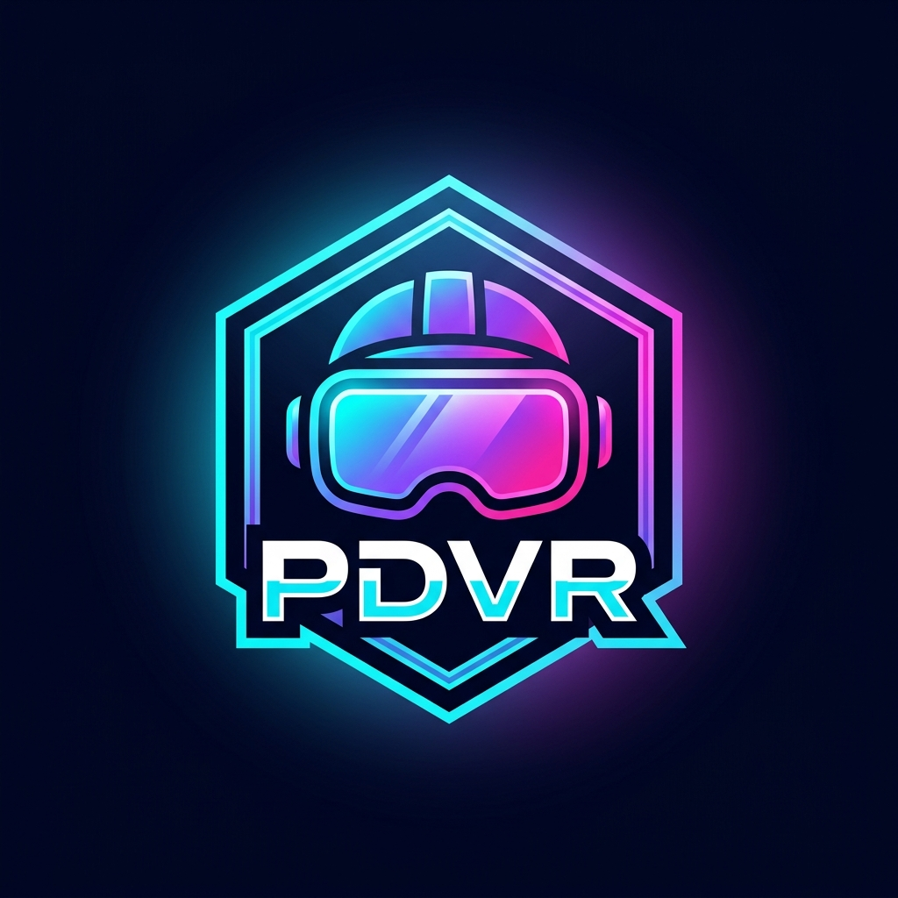

  

# 🎮 PDVR GAMING
### Virtual Reality Arcade · School STEM Labs · Creative Web &amp; PWA Studio

[-8B5CF6?style=for-the-badge)](https://pdvrgaming.github.io/#/experiences)

---

## 🌈 Welcome to PDVR Gaming

Based in **Vijayawada, Andhra Pradesh**, **PDVR Gaming** blends **high-octane commercial Virtual Reality entertainment** with **offline-first full-stack web & PWA engineering**:

- 🥽 **On-Site VR Arenas & Simulators:** High-refresh pancake-optic VR headsets, 360° thrill rides, boxing/cricket arenas & turnkey setups for **apartment carnivals, schools, and birthday celebrations**.
- ⚡ **Software & PWA Studio:** Building blazing-fast, zero-cloud, installable Progressive Web Applications using **React 19, TypeScript, Tailwind CSS, IndexedDB, Web Audio API & Tesseract OCR**.

---

## 🕹️ VR Experiences & Game Catalog (`pdvrgaming.github.io`)

<table width="100%">
  <thead>
    <tr>
      <th width="26%" align="left">Category</th>
      <th width="50%" align="left">Featured VR Titles</th>
      <th width="24%" align="left">Pricing / Format</th>
    </tr>
  </thead>
  <tbody>
    <tr>
      <td><strong>🎢 360° Adrenaline Rides</strong></td>
      <td>Roller Coaster VR &bull; Jurassic Park &bull; Santa Ride &bull; Henry (Emmy Story)</td>
      <td><code>₹100 – ₹150</code> · Ages 4+</td>
    </tr>
    <tr>
      <td><strong>⚔️ Action &amp; Motion VR</strong></td>
      <td>Beat Saber &bull; Iron Man VR &bull; Richie's Plank &bull; Cricket VR &bull; Boxing &bull; Horror</td>
      <td><code>₹150</code> · Live Spectator Screen</td>
    </tr>
    <tr>
      <td><strong>🔬 School STEM 3D Modules</strong></td>
      <td>Solar System &bull; Ocean Rift &bull; NASA Mission ISS &bull; 3D Human Anatomy</td>
      <td><code>₹300</code> · 15+ Mins Guided</td>
    </tr>
    <tr>
      <td><strong>🎪 Turnkey Mobile Events</strong></td>
      <td>Apartment Society Carnivals &bull; School Science Expos &bull; Birthday Arenas</td>
      <td><a href="https://pdvrgaming.github.io/#/events">Get Event Quote &rarr;</a></td>
    </tr>
  </tbody>
</table>

---

## 🚀 Featured Software & Open-Source Projects

<table width="100%">
  <thead>
    <tr>
      <th width="27%" align="left">Application</th>
      <th width="49%" align="left">Architecture &amp; Key Capabilities</th>
      <th width="24%" align="left">Live Link</th>
    </tr>
  </thead>
  <tbody>
    <tr>
      <td><strong>🎮 PDVR Gaming Platform</strong></td>
      <td>React 19 + TypeScript + Tailwind v4 showcase with interactive category filters, control panel CMS, WhatsApp enquiry builder &amp; local Vijayawada SEO.</td>
      <td><a href="https://pdvrgaming.github.io/">Launch Site &rarr;</a></td>
    </tr>
    <tr>
      <td><strong>🏥 MEDIC Health PWA</strong></td>
      <td>100% offline IndexedDB (16 stores) family medicine tracker, monthly calendar adherence streaks, 145+ PMBJP Jan Aushadhi &amp; NLEM salts, Indian accent voice TTS &amp; WhatsApp refills.</td>
      <td><a href="https://pdvrgaming.github.io/medic/">Open MEDIC &rarr;</a></td>
    </tr>
    <tr>
      <td><strong>📡 QuestCasting</strong></td>
      <td>Wireless Meta Quest browser casting &amp; session monitor for smooth public VR arena spectator displays.</td>
      <td><a href="https://pdvrgaming.github.io/questcasting/">Open Utility &rarr;</a></td>
    </tr>
    <tr>
      <td><strong>🏋️ GymMane PWA</strong></td>
      <td>Installable offline-capable fitness &amp; workout routine web app.</td>
      <td><a href="https://pdvrgaming.github.io/GymMane/">Open App &rarr;</a></td>
    </tr>
  </tbody>
</table>

---

## 🎨 Tech & Creative Stack

  
  
  
  
  
  
  
  

---

## 📸 Social & Business Channels

| Website | WhatsApp / Bookings | Email | Instagram | YouTube | Facebook |
| :---: | :---: | :---: | :---: | :---: | :---: |
| [pdvrgaming.github.io](https://pdvrgaming.github.io/) | [+91 9133020759](https://wa.me/919133020759) | [gamingpdvr@gmail.com](mailto:gamingpdvr@gmail.com) | [@pdvrgaming](https://instagram.com/pdvrgaming) | [@pdvrgaming](https://youtube.com/@pdvrgaming) | [@pdvrgaming](https://facebook.com/pdvrgaming) |

Open Daily 8:00 AM – 10:00 PM IST · Vijayawada, Guntur, Amaravati &amp; Andhra Pradesh

